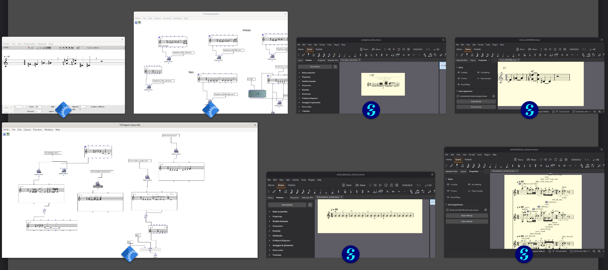

# OpenMusic &lrarr; Mscore - bridge between OpenMusic and MuseScore



A two-way bridge between OpenMusic and MuseScore notation.

Provides moving musical material between algorithmic composition in
OpenMusic and clean, editable notation in MuseScore.


## Main files

- `export-mscx.lisp` — OpenMusic → MuseScore MSCX
- `import-mscx.lisp` — MuseScore MSCX → OpenMusic
- `mscx-instrument-mappings.lisp` — Muse Sounds families, instrument names and vocabularies
- `mscx-expression.lisp` — OM extras, common notation and expression rendering
- `om-mscore-workspace/` and `mscores/` — test patches and reference scores

## Loading

With OpenMusic's MusicXML support already loaded:

```lisp
(load "/path/to/load-mscx.lisp")
```

## OM interface

```lisp
(export-mscx object clefs notation-scale path)
(import-mscx path)
```

&rarr; `export-mscx` writes a MuseScore score from an OM voice or poly;
<br>
&rarr; `import-mscx` returns an OM Poly object from a MuseScore score.

### Instrument mappings

```lisp
(mscx-export mypoly
  :path #P"/tmp/strings.mscx"
  :instrument-mappings :muse-strings
  :instruments '("strings.violin" "strings.violin" "strings.viola" "strings.cello"))
```

Use `:notation-only` (the default) for notation without new playback flags.
One mapping family can serve all voices; a list selects one family per voice.
The OM box `export-mscx-expression` retains its name and input count for now;
its fifth input is instrument mappings. `:expression-profiles` remains a
temporary keyword alias in `mscx-export`.

Edit/add `muse-sounds-family` and `instrument-mapping` definitions in the mapping
file. Each instrument can override fields in the family vocabulary, including
explicitly removing a playback ID with `:playing-technique nil`. This chooses
mappings; select the actual sound separately in MuseScore.

See [OM_MSCORE_INSTRUMENT_MAPPINGS.org](OM_MSCORE_INSTRUMENT_MAPPINGS.org) for the
data contract, extension example and OM8 export tests. The Strings prototype
contains Violin 1 Solo, Viola Solo and Cello Solo records. Playback evidence
from the user applies to Violin 1 Solo; other records inherit the prototype.

### More info, documentation and resources

&rarr; Project pages: [https://github.com/andersvi/OM_mscore](https://github.com/andersvi/OM_mscore)
<br>
&rarr; [MuseScore](https://musescore.org/nb)

------

### Download

## [Latest release](https://github.com/andersvi/OM_mscore/releases/latest)

------

### Credits

Design and development: Anders Vinjar

OM_mscore uses code from Karim Haddads MusicXML package, part of [OpenMusic](https://github.com/openmusic-project/openmusic/) 

------
